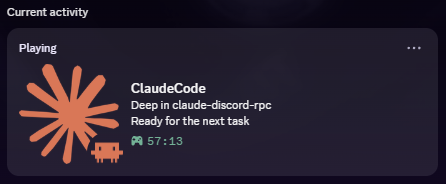
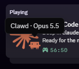

# claude-discord-rpc

Discord Rich Presence for [Claude Code](https://claude.com/claude-code). It shows what Claude is doing right now, project and action included:

<p>
  
  
</p>

- Starts and stops together with Claude Code. There is nothing to launch by hand and no Windows autostart entry.
- No dependencies: Python 3.11+ standard library only. It talks to Discord's local IPC pipe directly.
- Several phrasings for every state («Editing / Tweaking / Polishing main.py»). A phrasing is picked once when the state changes, so the status doesn't flicker.
- Privacy controls: hide file names or commands, or blacklist projects so they show as «Secret project». Command arguments are never shown.
- With several Claude Code sessions open, it shows the most recently active one plus the session count.

## How it works

```
Claude Code ──hook (stdin JSON)──> hook.py ──> %LOCALAPPDATA%\claude-discord-rpc\sessions\<id>.json
                                      │
                                      └─ starts daemon.py if it isn't running
daemon.py ──every 2 s: read sessions, build activity──> Discord IPC pipe (SET_ACTIVITY)
```

Hooks are short-lived processes, but Discord keeps a presence only while the IPC connection stays open. So a small background daemon owns the connection:

- The hook (~50 ms) records the session's current state and spawns the daemon on demand (`pythonw`, detached, no window).
- On Windows the daemon runs as `claude-rpc.exe`, a copy of `pythonw.exe` in `%LOCALAPPDATA%\claude-discord-rpc\`, so Task Manager lists it as «Claude Code Discord RPC» instead of «Python». The copy is refreshed automatically when Python is updated.
- The daemon sends updates only when something changes, and never more than once per 4 s, which keeps it under Discord's rate limit. If Discord restarts, it reconnects.
- When the last session ends, the presence is cleared and the daemon exits 2 minutes later.

Hooked events: `SessionStart`, `UserPromptSubmit`, `PreToolUse`, `Notification`, `Stop`, `SessionEnd`.

> Unofficial community project, not affiliated with or endorsed by Anthropic.

## Setup

```powershell
git clone <repo-url>
cd claude-discord-rpc
python install.py
```

That's it. Start a new Claude Code session with the Discord desktop app running.
`install.py` adds hooks to `~/.claude/settings.json` (a timestamped backup is made first) and creates `%APPDATA%\claude-discord-rpc\config.toml`.
If the status doesn't show up, enable *Discord → Settings → Activity Privacy → Share your detected activities with others*.

### Own Discord application (optional)

Want a different «Playing …» name or your own images? Create an app at <https://discord.com/developers/applications>, upload Art Assets named `logo` and `claude-code` (or set your own keys under `[images]`), then run `python install.py --client-id <Application ID>`.

Uninstall: `python install.py --uninstall`.

## Configuration

`%APPDATA%\claude-discord-rpc\config.toml` is reloaded automatically. See [`config.example.toml`](config.example.toml) for all options:

| Option | Default | Description |
|---|---|---|
| `privacy.show_files` | `true` | `Editing main.py` vs `Editing a file` |
| `privacy.show_commands` | `true` | `Running git` vs `Running a command` |
| `privacy.blacklist` | `[]` | glob patterns for project name/path → «Secret project» |
| `images.large` / `images.small` | `logo` / `claude-code` | Art Asset keys or https URLs |
| `images.large_text` / `images.small_text` | `claude.ai` / `Clawd · {model}` | hover texts, templates with `{model}`, `{state}` |
| `images.small_states.<state>` | – | per-state small icon |
| `buttons` | – | up to 2 link buttons |
| `phrases.<category>` | built-in | your own phrase pool for a state |
| `timing.stale_minutes` | `30` | drop sessions with no events (terminal closed abruptly) |

## Troubleshooting

| Symptom | Check |
|---|---|
| Nothing in Discord | `%LOCALAPPDATA%\claude-discord-rpc\daemon.log`: is the `client_id` set, and is the connection established? |
| Hook errors | `%LOCALAPPDATA%\claude-discord-rpc\hook-errors.log` |
| Inspect raw hook payloads | set `debug = true` → `payloads.log` |
| Watch the daemon live | `python claude_discord_rpc/daemon.py --stop`, then `python claude_discord_rpc/daemon.py --debug` |
| Is the daemon running? | Task Manager → «Claude Code Discord RPC» (`claude-rpc.exe` on the Details tab) |
| Image missing | the asset key must match exactly, and newly uploaded assets can take a few minutes |

## Development

```powershell
uv run pytest
```

## License

[MIT](LICENSE)
